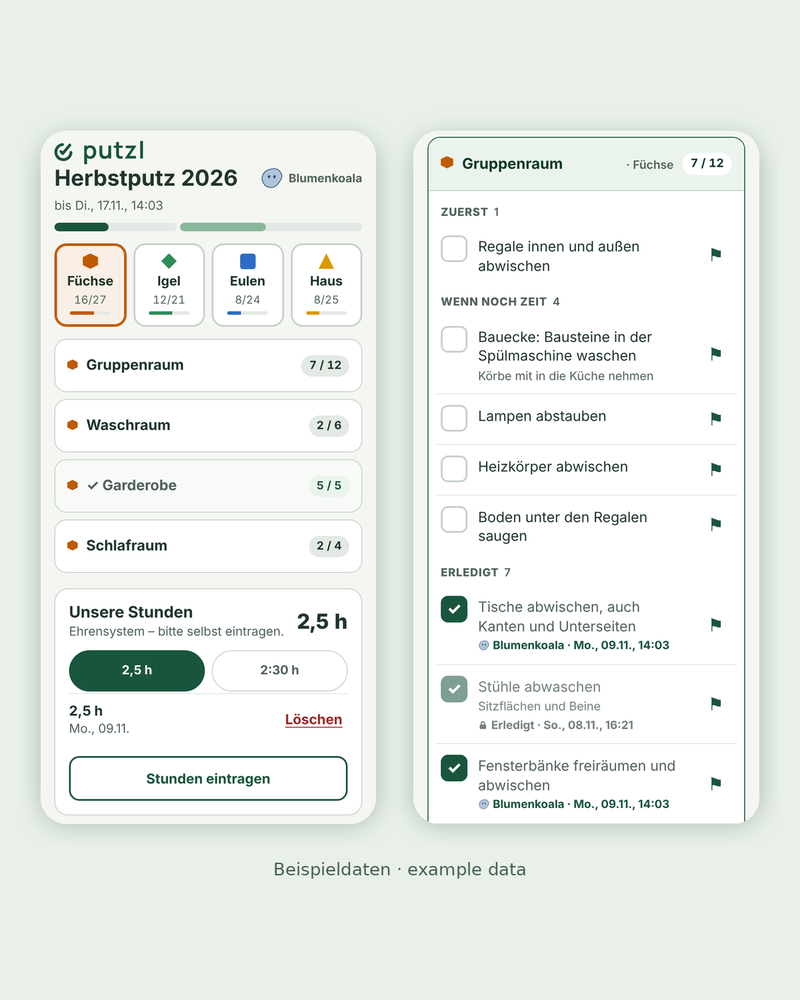

## Hands full

Picture a parent with a phone in one hand and a screaming child on the other arm,
while a smaller one is adamant they can climb that thing. Now ask them to operate an
app.

That parent is putzl's user, and the app makes them a single promise, which its
welcome page puts in one line: "Diese Seite zeigt, was noch zu tun ist" (this page
shows what still needs doing). Whenever a design question was open, the answer came
from that parent, because if they can't do it one-handed, in a few seconds and without
really paying attention, it's the wrong design.

## No hiring, no firing

Every family at a parent-run Kita in Aachen owes it two and a half hours of cleaning,
and this autumn the Orga set up links for 44 of them. None of them can be hired,
pushed or replaced, since the people doing the work are also the customers, as well as
the people the board answers to. Nor did anybody ask them whether they wanted an app.
They were given one, for a weekend many of them would rather have spent elsewhere.

That fixes the labour at about 110 hours, which leaves the list as the only thing
anyone can design; this autumn it ran to 284 tasks across four groups, to be done over
eleven days.

## Taking the spreadsheet apart

The list began on paper and moved to a spreadsheet on SharePoint, which held rather
more but wouldn't save from a phone. So the work had a walk around it. A family looked
at what was left at home, made a plan, drove to the Kita and hoped nothing had changed
on the way. They cleaned what they had chosen, then tried to open the sheet and update
it, or asked someone else to. Time and goodwill leaked out at every step, and these are
workers who don't get paid.

I didn't replace the sheet so much as take it apart. Its 290 rows went into a plain
text list, with the "Zuerst" tasks (the ones that matter most) lifted straight from
its yellow cells. Ten of those rows turned out to be duplicates that nobody could see
until the list was in pieces, so 290 rows became 280. Each group's Erzieher·innen, the
Kita's educators, then corrected their own part in an editor of their own, which left
284 tasks at the start.

## Constraints before code

Before any code, I wrote down what the parent with their hands full rules out. Each of
those constraints became a decision, and each decision has a number from the pilot
next to it.

| Decision | Why | What the pilot showed |
|---|---|---|
| No accounts, a link and a codename per family | Nobody logs in one-handed, and a Verein has nobody to run accounts | 32 teams took part with no onboarding, and nobody asked for help |
| A ticked task locks for every other team | Last year families cleaned what had already been done | The server never had to turn a second team away |
| Hours prefilled at 2.5, one tap, on honour | Goodwill counts for more than precise data when nobody is paid | Every team that ticked a task also entered its hours |
| No "are you sure?", undo close by instead | A second tap is one too many | 381 tick or untick calls for 241 tasks, corrections made cheaply |
| A link can be replaced without losing its history | Links will be shared | One link posted in a chat cost one message to fix |
| Every rule lives in the database, tested against a real one | The page shows a change before it lands and can hide a failed write | No server errors in 4,186 calls; the logs and the database agree to the row |

One constraint came from my other role. The Kita is an Elterninitiative, a 50-place
daycare run by its parents as a registered association, which is a common model in
Germany, and as a board member I'm one of the people answerable for the data it holds, so putzl keeps as little as it can: no names, no contact details, and a
codename that only the Orga can match to a family.

An early version timed each task and gave better data, but it lost to goodwill. The
spec keeps that decision and the reasons it was reversed, as it keeps every other one,
which turned out to matter more than I expected.

## Built for one, shaped for many

putzl was built for one Kita, but it was shaped for many from its second week. One
database holds any number of events, and the link a family taps decides which event
they see; nothing on the wire names an event at all. Yet the pilot needed none of it.
I built it anyway because this was always going to be the template for other Vereine,
schools and gardens, and because separating events after the fact means touching every
query and every test. Of course, that is a bet, and the pilot only proves the half of
it that one event can prove.

## How it was built

I wanted the spreadsheet gone from the day I decided to stand for the board, and from
the start I meant putzl to be two things at once, a fix for our Kita and a product,
because a Verein is a Verein, more or less. The thinking went into the spec, and took
as long as it took. So the build happened whenever I could make time for it, which
came to 18 days with commits spread over seven weeks, seven of them full days. Claude
agents did the building, with one model orchestrating others that wrote the code, and
later a second orchestrator took over the same spec. Of the 157 commits on the main
branch, 114 are the agents'.

What kept the agents coherent was the paperwork, not the prompts. The spec carries
every decision with its reasoning, and the first version, with every decision that was
later reversed and why, is kept verbatim. Seven browser suites run against a throwaway
Postgres built from the schema, never against a stub, because a stub would have hidden
the two worst bugs the project has had. And the proof came after the event, when a
fingerprint of every function, column and access rule in production matched the
repository, apart from two comment lines that the SQL editor strips and one helper
that Supabase adds itself.

## Eleven days

Help shipped with the tool, three weeks before the start: four help pages, one for
each role, and short screen videos. A preview video went into the Kita chat with ten
links anyone could try, and 31 views came from that. The help videos were barely
watched, and the ones for the Orga and the Erzieher·innen not at all. However, I read
that as help that existed and was hardly needed, which is the better outcome.

I had handed the event to the cleaning coordinator before it opened, and they ran it
without me, taking the exports on day three before anyone had thought to ask.

By the end, 32 teams had taken part, and they had done 85% of the list and 95% of what
the Kita had marked "Zuerst". Two weekends carried nearly all of it. As for the system itself, it
never logged a single server error.

Of course, two things went wrong. A parent posted their family's link in the Kita
chat, not seeing it as a key, so I replaced it with one message, which left the team
its history. But messages in that chat can't be deleted, and over the following week
links that no team holds were tried about thirty times, each one refused, before the
tries stopped. Most likely they were the old ones still sitting in the chat; whether
one travelled further, nobody can know.

The second was mine, and the agents'. I tested every screen at phone and laptop widths
and chose the layout by width, which is why a large tablet in landscape, being as wide
as a laptop, got the layout that is built for a mouse and a keyboard. Its user
struggled until we talked it through. Width had been standing in for input type, and
neither I nor the agents had noticed that we were testing two kinds of device where
there are three.

## Same work, less walking

Last year the spreadsheet ended with 242 of its 290 rows marked done. This year 242 of
284 tasks were ticked, so about as much got done. That was never the point, because
the hours set the amount of work and an app doesn't add hands. What changed is the walk
around the work, and a record that's easier to keep and harder to get wrong.

Hours tell the same story more quietly. Last year's sheet has 28 entries and 89 hours,
with a median of three hours per family; this year 32 teams entered 93.75, with a
median of two and a half. My hypothesis is that last year's extra half hour was the
admin around the sheet, booked as cleaning. But it may equally be people who stayed longer
and didn't change the prefilled number, and the data can't tell those apart.

The system cost almost nothing to run. The busiest minute of the event had 42 calls,
and 99% of calls on the three busiest days were answered in under half a second, none
in more than a second; reads are the slow end, because every one rebuilds the whole
board, and that's the next thing to fix. The whole event served about 62 MB, against 5
GB a month on the free plan.

## Hours, wishlists and a toilet brush

Two and a half hours buys about six tasks, so the minimum from every linked family
would have covered about 260 of the 284. Each group's list is part task list and part
wishlist, and it's meant to ask for more than the hours cover.

But some of it was never about hours. One task asked for a damp special clean of the
carpets, while another was to replace a toilet brush when there wasn't a new one
anywhere in the building, which made it a shopping trip rather than a cleaning job.
Parents said so in the app's reports, plainly and within a day. Neither is a job for
unpaid hours, and when unpaid hours are the only resource, things a small budget would
solve get complicated.

## From where I sit

This was one event, with an audience that had no choice and a developer on the board,
which makes the second cycle the real test. So two fixes come first. The teardown that ends an
event checks that its exports exist but not that they're current, which the reset
already does. And every open board refetches everything every thirty seconds, where it
should only ask whether anything changed.

Beyond those, I'd change four things in putzl.

- Nothing for the Erzieher·innen. Their job is the children.
- Screens that follow the event's phase, with the Orga's overview first while it runs.
- A third outcome for a task besides open and done: tried, but blocked, and why.
- Layout by input, not just width, with tablets in the tests.

putzl didn't invent anything. It made the work easier for the people who do it, which
is also how I'd measure it. If a usage dashboard rated putzl dead, it did its job,
because people should come in, change something in the world, and leave.

The event closed on 9 November. The toilet brush is still on the list, and now there
are two.

## Evidence

| | |
|---|---|
| Family links, tasks, window | 44 links, 284 tasks (170 "Zuerst"), 30 Oct to 9 Nov |
| Teams that took part | 32, every one with ticks and hours |
| Tasks done | 242 of 284 (85%); "Zuerst" 161 of 170 (95%) |
| Last year, from the spreadsheet | 290 rows (10 of them duplicates), about 48 not marked done; 28 hours entries, 89 hours |
| Hours this year | 93.75; median 2.5 per team |
| Tasks per claimed hour | median 2.4 per team, so 2.5 hours buys about 6 |
| The two weekends' share of the ticks | 221 of 241 |
| Help requests, messages to the Orga | none |
| Help shipped | four help pages and short videos, from 10 Oct; preview video 31 views, help videos 8 views in all, Orga and Erzieher videos none |
| Build | 18 days with commits between 11 Sep and the start on 30 Oct, 7 of them full days; 157 commits on main, 114 by agents; seven browser suites against a real database |
| Production against the repository | identical apart from two stripped comments and one Supabase helper |
| API calls, server errors | 4,186 calls, none failed on the server |
| Response times, three busiest days | median about 50 ms; 99% under half a second; slowest 836 ms |
| Busiest minute | 42 calls |
| Data served | about 62 MB in all, against 5 GB a month on the free plan |
| Old-link tries after the rotation | about 30, all refused; none after 7 Nov |
| Writes in the logs vs the database | identical, 39 hours entries and 36 reports |

putzl keeps no names, accounts or contact details. Its database keeps no IP
addresses; the hosting platforms log them for some days, as all web hosting does.
